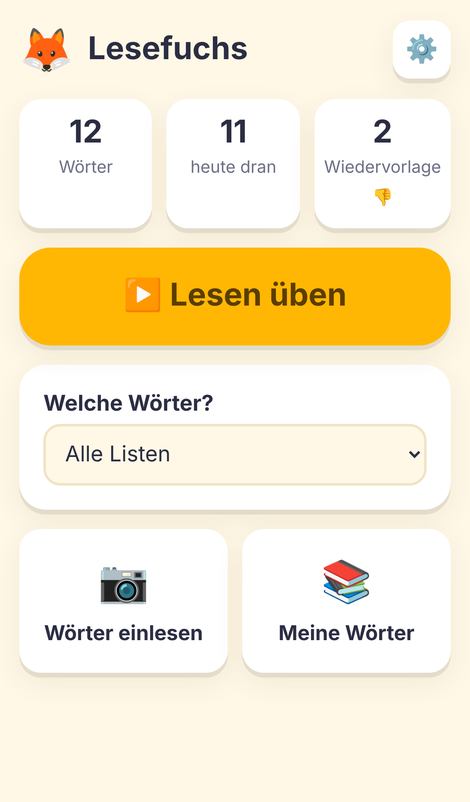
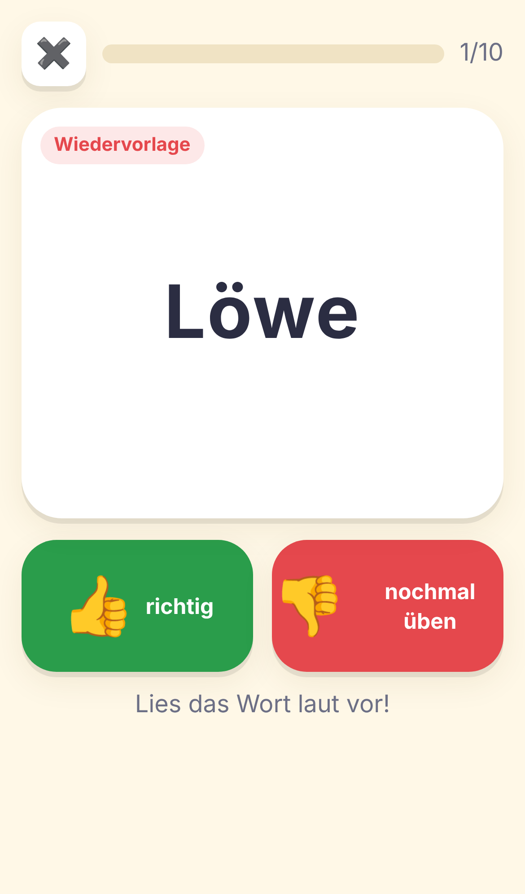
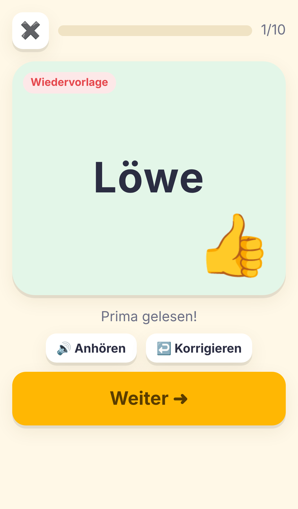
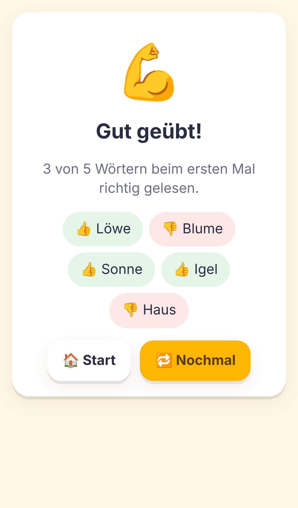
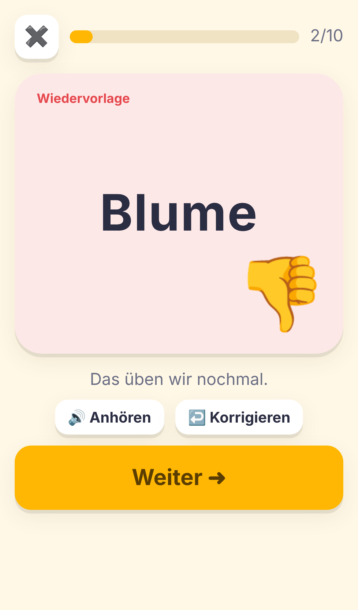
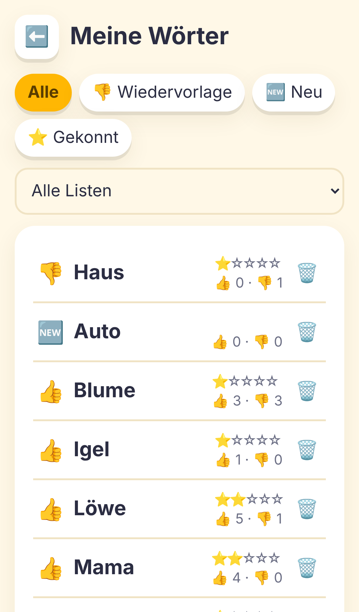
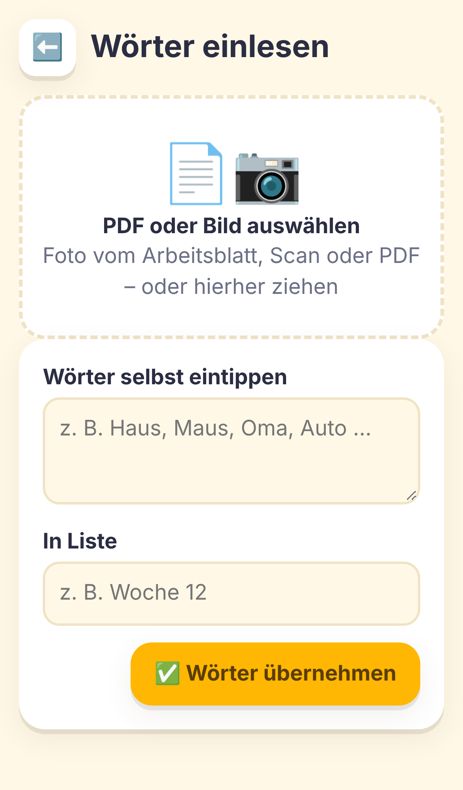

# 🦊 Lesefuchs

**Lesen üben mit den Wörtern vom eigenen Arbeitsblatt.**
Eine kleine Lern-App für Leseanfänger: Wörter aus einem Foto, Scan oder PDF einlesen und mit einem Karteikasten üben. Das Kind liest vor, ein Erwachsener tippt 👍 oder 👎.

▶️ **Direkt ausprobieren:** https://marwaeck.github.io/Lesefuchs/

| Start | Üben | Richtig gelesen | Ergebnis |
|:---:|:---:|:---:|:---:|
|  |  |  |  |

| Nochmal üben | Meine Wörter | Wörter einlesen |
|:---:|:---:|:---:|
|  |  |  |

## So funktioniert's

1. **Wörter einlesen** – Foto vom Arbeitsblatt, Bild oder PDF auswählen. Die App findet die Wörter (PDF mit Text direkt, Fotos und gescannte PDFs per Texterkennung auf Deutsch). Du wählst aus, welche geübt werden. Wörter lassen sich auch eintippen und in Listen sortieren (z. B. „Woche 12“).
2. **Lesen üben** – Ein Wort erscheint groß. Das Kind liest es laut vor:
   - 👍 **richtig** – das Wort wandert ein Fach weiter und kommt erst später wieder (nach 1, 2, 4, 8, 16 Tagen).
   - 👎 **nochmal üben** – das Wort kommt in die Wiedervorlage: in derselben Runde ein paar Wörter später nochmal und in der nächsten Runde wieder ganz vorne. Auf Wunsch spricht die App das Wort vor.
3. **Meine Wörter** – Übersicht mit 👍/👎 je Wort und Filtern für Wiedervorlage, neue und gekonnte Wörter.

**Einstellungen:** Wörter pro Runde, GROSSBUCHSTABEN, Wort nach 👎 vorsprechen, Hell/Dunkel und optional das Mikrofon (die App hört beim Vorlesen zu und bewertet selbst; „Korrigieren“ dreht jede Bewertung um).

## Gut zu wissen

- **Läuft komplett im Browser** – auf Tablet, Handy oder Computer, ohne Anmeldung und ohne Server. Auf dem iPhone/iPad über *Teilen → Zum Home-Bildschirm* als App installierbar.
- **Daten bleiben auf dem Gerät** (im Browser gespeichert). Über *Einstellungen → Sicherung speichern/laden* lassen sich die Wörter als Datei sichern oder auf ein anderes Gerät übertragen.
- **Schrift:** [Andika](https://software.sil.org/andika/) – gemacht für Leseanfänger (eindeutige Formen von a, l, I).

## Technik

- Eine einzige Seite (`index.html`) ohne Build-Schritt, gehostet mit GitHub Pages aus `main`.
- Texterkennung: [Tesseract.js](https://github.com/naptha/tesseract.js) (Deutsch), PDFs: [PDF.js](https://mozilla.github.io/pdf.js/) – beide werden erst beim Einlesen geladen.
- Wiederholung nach dem Leitner-Karteikasten (5 Fächer).
- Optional vorbereitet: gemeinsame Wörter für die Familie über Firebase (`firebase-config.js`, `firestore.rules`) – standardmäßig aus.
- Die Screenshots oben (`docs/screenshots/`) lassen sich mit Beispielwörtern neu erzeugen: `npm i playwright && node .github/scripts/screenshots.mjs <URL>`.
